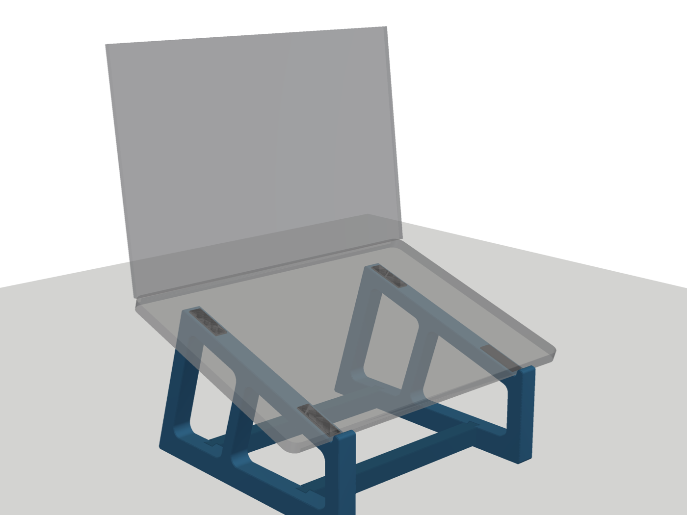

# MacBook Pro 14" (PROLED, 2026) riser — Bambu X1C

A riser with two side frames, two crossbars and TPU pads, sized for the MacBook Pro 14" with PROLED XDR display (310.8 × 216.3 × 15.0 mm).



| | default |
|---|---|
| Tilt | 18° |
| Laptop bottom at front lip | ~82 mm above desk |
| Laptop bottom at rear | ~149 mm |
| Screen top (lid at ~115°) | ~365 mm above desk |
| Footprint | 231 × 243 mm |
| PETG | ~254 g, ~5 h 53 min (2 plates) |
| TPU 90A | ~12 g, ~57 min |

## Files

| File | What | Material | Qty |
|---|---|---|---|
| `bambu/riser_PETG_frames_crossbars.3mf` | Ready-sliced project: plate 1 is the left frame and both crossbars, plate 2 is the right frame | PETG | — |
| `bambu/riser_TPU90A_pads_x8.3mf` | Ready-sliced project with 8 pads | TPU 90A | — |
| `bambu/fit_test_PETG.3mf` | 25-minute test of the dovetail and pad pocket. **Print this first.** | PETG | — |
| `stl/frame_left.stl`, `stl/frame_right.stl` | Side frames, already in print orientation | PETG | 1 each |
| `stl/crossbar_x2.stl` | Crossbar | PETG | 2 |
| `stl/tpu_pad_x8.stl` | Pad (the same pad goes in all 8 pockets) | TPU 90A | 8 |
| `stl/fit_test_*.stl` | Fit-test socket block and tenon stub | PETG | 1 each |
| `macbook_riser.py` | Parametric generator. It rebuilds every STL and re-runs the fit checks. | | |
| `render_preview.py` | Rebuilds the images in `preview/` | | |

The project files were sliced with the **Bambu PETG HF** and **Bambu TPU 90A** presets. If your spool is PETG Basic, switch the filament preset in Bambu Studio and re-slice. Nothing else needs to change.

## Print settings

**PETG (frames and crossbars)**
- Textured PEI plate. The outer face of each frame prints on the plate, so the visible side gets the texture.
- 0.20 mm layers, **4 walls**, 15 % gyroid infill, 5 top and 4 bottom layers.
- **No supports, no brim.** The frames are 2.5D extrusions, and the only overhangs are small pocket ceilings (1.2 mm) and the 23° dovetail flanks.
- Don't rotate the frames. Printed flat, the layers run along the frame, so every load is carried by continuous perimeters.
- If the PETG strings, dry it (65 °C for 4–6 h).

**TPU 90A (pads)**
- TPU 90A **can't go through the AMS**. Feed it from the external spool holder and choose "External spool" when you send the print.
- Use the stock Bambu TPU 90A profile. The project is set to solid pads (6 top and 6 bottom layers).

**Why PETG rather than PLA Matte?** The bottom of the MacBook gets warm under load, and PLA starts to creep at around 50–55 °C. The TPU pads hold the aluminum 1.2 mm off the frame, so PLA Matte would probably be fine and would look nicer. PETG gives more margin, for example if the stand ever sits in a hot car or in direct sun.

## Fit test first (25 min)

1. Print `fit_test_PETG.3mf` and one TPU pad.
2. **Dovetail:** the tenon stub should drop into the socket with light-to-firm hand pressure, with no wobble.
   - Too tight: `python3 macbook_riser.py --set fit_side=0.2`
   - Too loose: `python3 macbook_riser.py --set fit_side=0.1`
3. **Pad:** it should press into the pocket snugly and stand about 1.2 mm proud. If it's loose, use a dot of CA glue or a small piece of thin double-sided tape.

## Assembly

1. Press the 8 pads in: 2 on top of each rail and 2 under each base.
2. Stand the frames upright about 195 mm apart, with the sockets (the notches on the base bar) facing each other.
3. For each crossbar: hold it level just above the base bars, push one end through that frame's window, swing the other end into the other frame's window, and centre it. Then **drop both tenons straight down** into the sockets.
4. Set the MacBook on the stand with its front edge against the lips.

The dovetails stop the frames from spreading apart. Gravity and the laptop keep the crossbars seated, and when you lift the stand the crossbars lift with it.

## Clearances built in
- The rails sit **40 mm inboard** of the laptop's side edges (pad contact is 43–55 mm in). This keeps the side intake slots, the rubber feet near the corners and both sides' ports clear. Nothing is behind the hinge, so the rear exhaust is open.
- The lip stands 6.8 mm above the pads. It catches the front edge without reaching the palm rest.
- The rear feet reach 45 mm behind the rail to resist tipping when you tap the touchscreen. A tap needs roughly 4 N (~400 g) at the top of the screen to start tipping it. The hinge gives way before that.

## Changing the shape

```bash
python3 macbook_riser.py                    # default (18°, ~82 mm front)
python3 macbook_riser.py --preset tall      # 20°, ~112 mm front, screen top ~403 mm
python3 macbook_riser.py --preset low       # 12°, ~57 mm front, screen top ~316 mm
python3 macbook_riser.py --set tilt_deg=15 front_height=90
python3 render_preview.py                   # refresh preview images
```

Every run checks that the frame fits the 256 mm bed, that the laptop and crossbars don't collide with the frames, and that the crossbars can still be dropped in. It prints a warning if any of those fail. The minimum front height is about 55 mm, because the crossbar joints need room above the base bar.

Needs `pip install manifold3d shapely trimesh numpy` (and `pyvista matplotlib` for the previews).

## Dimension source
The PROLED model's size is from [MacRumors](https://www.macrumors.com/2026/10/28/oled-macbook-pro-size-weight/) (12.24 × 8.52 × 0.59 in). The design isn't sensitive to a millimetre or two either way.
